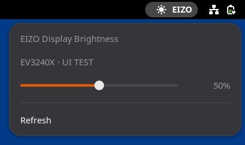

# EIZO Brightness for GNOME

English | [日本語](README.md)

Change the hardware brightness of an EIZO display with a slider in the GNOME top bar. EIZO's official [Screen InStyle](https://www.eizo.co.jp/products/lcd/screeninstyle/index.html) targets Windows and macOS, so this extension was built for Ubuntu.



<sub>Screenshot from the UI test. On a real monitor, the serial number appears in place of "UI TEST".</sub>

**This is an early prototype for the EV3240X.** Monitors that use the same protocol are also detected, but other models are untested.

## Features

- Change the brightness from 0 to 100% with a slider in the top bar's EIZO menu
- Control each monitor separately when several are connected
- Read the value back from the monitor after each change and show what actually took effect
- Check and change the brightness from a terminal

## Requirements

| Item | Requirement |
| --- | --- |
| Desktop | Ubuntu 26.04 / GNOME Shell 50 / Wayland |
| Monitor | FlexScan EV3240X (USB ID `056d:4081`) |
| Connection | USB data connection between the PC and the monitor |
| Python | 3.10 or later (uses Ubuntu's `/usr/bin/python3`; no extra packages needed) |

A video cable alone is not enough. A USB-C connection may carry both video and data. With HDMI or DisplayPort, also connect the monitor's USB upstream port.

## Installation

```sh
git clone https://github.com/kelsonire/gnome-eizo-brightness.git
cd gnome-eizo-brightness
# Allow the desktop user to access the monitor over USB
sudo install -m 0644 udev/70-eizo-brightness.rules /etc/udev/rules.d/
sudo udevadm control --reload-rules
sudo udevadm trigger --subsystem-match=hidraw
# Build and install the extension
make package
gnome-extensions install --force dist/eizo-brightness@local.shell-extension.zip
```

**Log out and back in**, then run `gnome-extensions enable eizo-brightness@local`. **EIZO** appears in the top bar.

## Usage

Open **EIZO** in the top bar and move the slider. With several monitors connected, each one has its own slider.

After reconnecting USB or changing the brightness on the monitor itself, reopen the menu or choose **Refresh**.

### Command line

```sh
/usr/bin/python3 extension/eizo_brightness.py list     # List connected monitors and their brightness
/usr/bin/python3 extension/eizo_brightness.py get      # Show the current brightness
/usr/bin/python3 extension/eizo_brightness.py set 50   # Set the brightness to 50%
```

With several monitors, pass a device name from `list` to `--device`. Names such as `/dev/hidraw1` change with the connection order. Add `--json` to any command for JSON output.

```sh
/usr/bin/python3 extension/eizo_brightness.py set 30 --device /dev/hidraw1
/usr/bin/python3 extension/eizo_brightness.py list --json
```

Values are 0–100%. They are converted to the brightness range reported by the USB device and rounded to its step size.

## Troubleshooting

| Message | What to do |
| --- | --- |
| No EIZO monitor found | Check the USB data connection (see [Requirements](#requirements)). |
| The monitor is not responding | Check the USB connection. |
| No permission to access the USB device | Run the `sudo` commands in [Installation](#installation), then reconnect the monitor's USB cable. |
| The monitor rejected the brightness change | Check the display mode on the monitor. |
| The brightness does not match the requested value | Auto EcoView or the display mode may have changed the value. Check the monitor's settings. |
| Detected a conflict with other monitor control software | Stop other software that controls the same monitor, then choose **Refresh**. |
| The HID descriptor has a duplicate control | Reinstall the latest version, as described below. |

### "The HID descriptor has a duplicate control"

The EV3240X uses usage `ff01:00fe`, which is unrelated to brightness, in several reports ([device report](https://github.com/markbolhuis/libeizo/issues/10)). Older versions required every usage in the descriptor to be unique, so this stopped brightness control too. The current version validates only the usages needed for brightness and USB communication.

To get the fix, rerun `make package` and `gnome-extensions install` from [Installation](#installation), then choose **Refresh** in the EIZO menu. The Python helper starts fresh for each operation, so this fix does not require logging out.

If a required item itself is duplicated, the error includes its usage number.

## Disable or remove

```sh
gnome-extensions disable eizo-brightness@local
gnome-extensions uninstall eizo-brightness@local
```

If you installed the udev rule, remove it as well.

```sh
sudo rm /etc/udev/rules.d/70-eizo-brightness.rules
sudo udevadm control --reload-rules
```

## For developers

### Architecture

```text
Top bar menu (extension.js)
  │  starts a subprocess per operation and reads its JSON result
  ▼
USB HID helper (eizo_brightness.py)
  │  reads and writes /dev/hidraw*
  ▼
EIZO monitor
```

The GNOME Shell menu and slider are written in JavaScript, and low-level USB access uses the Python standard library. Because USB work runs in a subprocess, the GNOME desktop stays responsive while waiting for the device.

- `extension/extension.js`: The GNOME Shell top bar menu. Runs communication in asynchronous subprocesses and coalesces rapid slider changes into one write every 250 ms.
- `extension/eizo_brightness.py`: The USB HID helper, using only the standard library. Handles device discovery, descriptor parsing, and reading, setting, and re-reading brightness.
- `udev/70-eizo-brightness.rules`: Access rule for the EV3240X.
- `tests/test_brightness.py`: Tests against real primary HID and settings descriptors, covering data layout, range validation, communication conflicts, and the re-read after setting.

### Tests

```sh
make test        # Unit tests and a syntax check of extension.js (requires Node.js)
make shell-test  # Verifies the UI in an isolated headless GNOME session (no hardware needed)
```

`make shell-test` also saves a screenshot to `dist/ui-preview.png`. The README image `docs/ui-preview.png` is a crop of it.

## References

- [EIZO Screen InStyle](https://www.eizo.co.jp/products/lcd/screeninstyle/index.html) (in Japanese): The official tool for Windows and macOS. The page also lists the USB connection requirements.
- [libeizo](https://github.com/markbolhuis/libeizo): An existing project that researched USB communication for EIZO FlexScan monitors, used as a protocol reference.
- [EV3240X descriptor report](https://github.com/markbolhuis/libeizo/issues/10): Reports the brightness usage `0082:0010` and a value range of 0–200.
- [Linux hidraw API](https://www.kernel.org/doc/html/latest/hid/hidraw.html): Reading and writing feature reports.
- [GNOME extension development guide](https://gjs.guide/extensions/development/creating.html).
