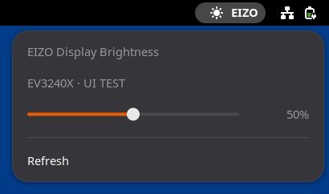

# EIZO Brightness for GNOME

[English](README.en.md) | 日本語

EIZOディスプレイ本体の輝度を、GNOMEの上部バーからスライダーで変更できる拡張機能です。EIZO公式の[Screen InStyle](https://www.eizo.co.jp/products/lcd/screeninstyle/index.html)はWindows/macOS向けのため、Ubuntuで使えるものとして作りました。



<sub>UIテストの画面です。実機では「UI TEST」の位置にシリアル番号が表示されます。</sub>

**現段階ではEV3240X向けの試作です。** 同じ通信方式の機種も検出できますが、他機種は未検証です。メニューとメッセージは英語で表示されます。

## できること

- 上部バーの「EIZO」を開き、スライダーで輝度を0〜100%の範囲で変更する
- 複数台接続時は、モニターごとのスライダーで個別に変更する
- 変更後に機器から値を読み直し、実際に反映された輝度を表示する
- 端末からコマンドで輝度を確認・変更する

## 動作環境

| 項目 | 条件 |
| --- | --- |
| デスクトップ | Ubuntu 26.04 / GNOME Shell 50 / Wayland |
| モニター | FlexScan EV3240X（USB ID `056d:4081`） |
| 接続 | PCとモニター間のUSBデータ接続 |
| Python | 3.10以降（Ubuntuの `/usr/bin/python3` を使用。追加パッケージは不要） |

映像ケーブルだけでは操作できません。USB-C接続なら映像と共用できる場合があります。HDMI/DisplayPort接続の場合は、USBアップストリーム接続も用意してください。

## インストール

```sh
git clone https://github.com/kelsonire/gnome-eizo-brightness.git
cd gnome-eizo-brightness
# デスクトップユーザーにモニターのUSBアクセスを許可する
sudo install -m 0644 udev/70-eizo-brightness.rules /etc/udev/rules.d/
sudo udevadm control --reload-rules
sudo udevadm trigger --subsystem-match=hidraw
# 拡張をビルドしてインストールする
make package
gnome-extensions install --force dist/eizo-brightness@local.shell-extension.zip
```

**ログアウトして再ログイン**し、`gnome-extensions enable eizo-brightness@local` を実行すると、上部バーに「EIZO」が表示されます。

## 使い方

上部バーの「EIZO」を開き、スライダーを動かします。複数台接続時は各モニターにスライダーが付きます。

USBの抜き差しや本体側での変更後は、メニューを開き直すか「Refresh」を選びます。

### コマンドから操作する

```sh
/usr/bin/python3 extension/eizo_brightness.py list     # 接続中のモニターと輝度を一覧表示
/usr/bin/python3 extension/eizo_brightness.py get      # 現在の輝度を表示
/usr/bin/python3 extension/eizo_brightness.py set 50   # 輝度を50%にする
```

複数台ある場合は、`list`で表示されたデバイス名を`--device`で指定します。`/dev/hidraw1`という番号は接続順によって変わります。各コマンドに`--json`を付けると、結果をJSONで出力します。

```sh
/usr/bin/python3 extension/eizo_brightness.py set 30 --device /dev/hidraw1
/usr/bin/python3 extension/eizo_brightness.py list --json
```

表示・操作の値は0〜100%です。USB機器が返す輝度の最小値・最大値に換算し、機器の刻みに丸めて設定します。

## うまくいかないとき

| 表示されるメッセージ | 対処 |
| --- | --- |
| No EIZO monitor found | USBのデータ接続を確認します（[動作環境](#動作環境)）。 |
| The monitor is not responding | USB接続を確認します。 |
| No permission to access the USB device | [インストール](#インストール)の`sudo`のコマンドを実行し、モニターのUSB接続を抜き差しします。 |
| The monitor rejected the brightness change | モニター本体の表示モードを確認します。 |
| The brightness does not match the requested value | Auto EcoViewや表示モードによって値が変わった可能性があります。本体の設定を確認します。 |
| Detected a conflict with other monitor control software | 同じモニターを操作している他のソフトを止めてから、「Refresh」を選びます。 |
| The HID descriptor has a duplicate control | 下記のとおり、最新の版に入れ直します。 |

### 「The HID descriptor has a duplicate control」と表示される場合

旧版では「HID記述子に重複する操作項目があります」と表示されていたエラーです。

EV3240Xは、輝度とは無関係なUsage `ff01:00fe`を複数のレポートで使います（[実機報告](https://github.com/markbolhuis/libeizo/issues/10)）。旧版では記述子全体でUsageが一意であることを要求していたため、輝度調整も中断していました。現在は輝度とUSB通信に必要なUsageだけを選んで検証します。

修正版を反映するには、[インストール](#インストール)の`make package`と`gnome-extensions install`を再実行し、EIZOメニューの「Refresh」を選んでください。Pythonヘルパーは操作ごとに起動するため、この修正の反映にログアウトは不要です。

必要な項目自体が重複する場合は、対象のUsage番号を含むエラーを表示します。

## 無効化・削除

```sh
gnome-extensions disable eizo-brightness@local
gnome-extensions uninstall eizo-brightness@local
```

udevルールを導入した場合は、ルールも削除します。

```sh
sudo rm /etc/udev/rules.d/70-eizo-brightness.rules
sudo udevadm control --reload-rules
```

## 開発者向け

### 構成

```text
上部バーのメニュー（extension.js）
  │  操作ごとに子プロセスを起動し、結果をJSONで受け取る
  ▼
USB HIDヘルパー（eizo_brightness.py）
  │  /dev/hidraw* を読み書きする
  ▼
EIZOモニター
```

GNOME ShellのメニューとスライダーはJavaScriptで実装し、USBへの低レベルな読み書きはPythonの標準ライブラリで行います。子プロセスに分けているため、USB通信を待っている間もGNOMEの画面は応答し続けます。

- `extension/extension.js`: GNOME Shellの上部バーメニュー。通信を非同期の子プロセスで実行し、スライダー操作の連続送信を250msにまとめます。
- `extension/eizo_brightness.py`: 標準ライブラリだけで動くUSB HIDヘルパー。機器検出、記述子の読込、輝度の取得・設定・再読込を担当します。
- `udev/70-eizo-brightness.rules`: EV3240X用のアクセス権設定。
- `tests/test_brightness.py`: 実機の一次HID記述子・設定記述子、通信データの並び、範囲検証、通信競合、設定後の再読込を検証します。

### テスト

```sh
make test        # 単体テストとextension.jsの構文チェック（Node.jsが必要）
make shell-test  # 隔離したヘッドレスのGNOMEセッションでUIを検証（実機は不要）
```

`make shell-test`は`dist/ui-preview.png`にスクリーンショットも保存します。READMEの画像`docs/ui-preview.png`は、これをクロップしたものです。

## 参考資料

- [EIZO Screen InStyle公式ページ](https://www.eizo.co.jp/products/lcd/screeninstyle/index.html): 公式版はWindows/macOS向け。USB接続の要件も記載されています。
- [libeizo](https://github.com/markbolhuis/libeizo): EIZO FlexScan用USB通信を調査した既存プロジェクト。通信形式の調査に参照しています。
- [EV3240Xの記述子報告](https://github.com/markbolhuis/libeizo/issues/10): 輝度のUsage `0082:0010`、値の範囲0〜200の報告。
- [Linux hidraw API](https://www.kernel.org/doc/html/latest/hid/hidraw.html): Feature Reportの読み書き。
- [GNOME拡張の開発手順](https://gjs.guide/extensions/development/creating.html)。
